<!-- Faixa do topo -->

  

<!-- Frase digitando -->

  

  
  
  

---

## Sobre mim

  

  Estou cursando <b>Análise e Desenvolvimento de Sistemas</b> e estou no <b>4º período</b>. 
  Adoro colocar minha criatividade e minhas ideias em sites funcionais e dinâmicos, 
  unindo <b>beleza</b>, <b>praticidade</b> e <b>segurança</b>.

<table align="center">
  <tr>
    <td align="center" width="160"><h3>3</h3>sistemas em uso na Inovee</td>
    <td align="center" width="160"><h3>1.600+</h3>testes automatizados</td>
    <td align="center" width="160"><h3>88 mil</h3>linhas de código escritas</td>
    <td align="center" width="160"><h3>12</h3>repositórios no GitHub</td>
  </tr>
</table>

---

## Tecnologias

   
   
  

  
  

Medido no código dos meus repositórios, públicos e privados, em novembro de 2026.

---

## Sistemas da Inovee Contabilidade

  

  
  

## Outros projetos

  
  

  
  

---

## Meu GitHub

  
  

## Atividade

### Cobrinha comendo minhas contribuições

  

<!-- Rodapé -->

  

